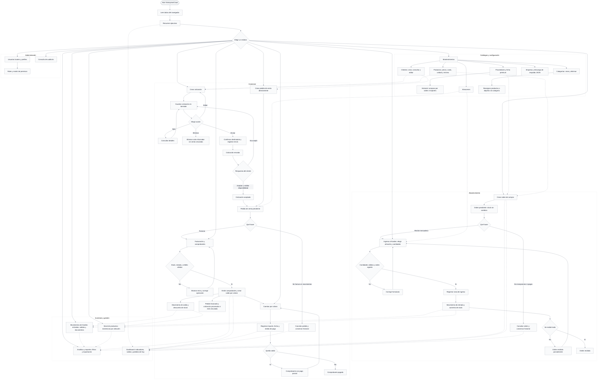

# Flujo general de EnterpriseCloud ERP

Este diagrama representa las pantallas y acciones implementadas. Las flechas continuas indican el recorrido operativo; las discontinuas indican consultas y actualización de información. Se puede ampliar el diagrama desde GitHub.

## Reglas del recorrido

- Crear una orden de compra no aumenta stock; confirmar su recepción crea la nota de ingreso y la entrada de inventario.
- Aceptar una cotización crea el pedido vinculado. El pedido verifica disponibilidad, pero no reserva ni descuenta stock.
- Facturar comprueba nuevamente disponibilidad y, si corresponde, crédito; genera el comprobante, la salida de inventario y la deuda. Una venta al contado también requiere registrar el cobro por separado.
- La cancelación conserva el documento. Compras exige que no existan recepciones, movimientos ni pagos; ventas exige que no exista factura, movimiento ni cobro. No hay reversión de ingresos ni anulación fiscal implementada.
- Una cotización aceptada o procesada no se edita ni elimina. Una enviada solo ofrece consulta y respuesta del cliente. El rechazo la devuelve a borrador.
- Enviar cotización registra el estado y muestra el correo del cliente; no envía un correo real. Los comprobantes tampoco se remiten a SUNAT.
- Los formularios y listas operativas abren con la fecha actual; sus filtros permiten consultar otras fechas. El dashboard muestra únicamente pedidos de hoy y el gráfico diario del mes hasta hoy.
- Las operaciones válidas se guardan y actualizan las consultas relacionadas. Consultar, filtrar, exportar o cobrar no mueve inventario.

Fuentes del código: [model.ts](../frontend/src/erp/model.ts), [pages.tsx](../frontend/src/erp/pages.tsx), [receiving.tsx](../frontend/src/erp/receiving.tsx), [catalogs.tsx](../frontend/src/erp/catalogs.tsx).
