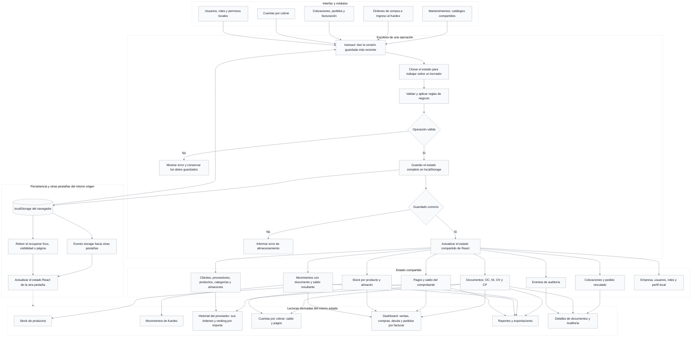

# Funcionamiento y conexión de módulos

La aplicación es una SPA React + TypeScript. Vercel publica los archivos compilados; las operaciones se procesan en el navegador. Todos los módulos utilizan el mismo estado mediante `ErpProvider` y `useErp`.

## Qué hace cada módulo

| Módulo | Función y datos de entrada | Qué crea o actualiza | Cómo se conecta |
|---|---|---|---|
| Resumen ejecutivo | Lee documentos, cobros, stock y movimientos. | Calcula indicadores, pedidos por facturar, alertas y comparación diaria de ventas/compras hasta hoy. No crea operaciones. | Refleja las transacciones guardadas; las órdenes recientes son solo de hoy. |
| Órdenes de compra | Selecciona proveedor, productos, cantidades, costos y almacén. | Crea una OC pendiente; permite cancelarla antes de recibirla y sin pagos. | Usa Mantenimiento. Alimenta los pendientes de recepción, historial del proveedor y reportes. No aumenta stock al crearla. |
| Ingreso al Kardex | Elige una OC pendiente o parcialmente recibida y cantidades por recibir. | Crea NI, movimientos de entrada y stock. Actualiza cantidades recibidas y estado de la OC. | Conecta compra, almacén, Stock de productos y Movimientos de Kardex. |
| Cotizaciones | Usa cliente, productos, precios y condiciones. | Guarda borrador, registra envío y respuesta. Aceptar crea una OV vinculada. Solo un borrador sin venta puede eliminarse. | Comparte clientes y productos con ventas. Conserva copias de los datos comerciales al guardar. |
| Pedidos de venta | Recibe una cotización aceptada o un pedido creado directamente. | Crea OV pendiente; comprueba stock sin reservarlo. Permite cancelar antes de facturar. | Proporciona el documento origen para Facturación. Cancelar lo retira de los pendientes. |
| Facturación y comprobantes | Toma la OV pendiente, fecha y tipo de comprobante. | Verifica estado, stock y crédito; crea CP, movimiento de salida y deuda. Marca la OV facturada y su cotización procesada. | Reduce stock, aparece en Cuentas por cobrar y alimenta dashboard/reportes. |
| Cuentas por cobrar | Consulta comprobantes emitidos y registra cobros. | Añade pagos con referencia interna, reduce el saldo y cambia a Pago parcial o Pagada. | Incluye contado, transferencia y crédito. No descuenta stock nuevamente. |
| Movimientos de Kardex | Consulta movimientos generados por ingresos y facturas. | Filtra entradas/salidas y permite ver su documento de origen. | Es la trazabilidad del inventario; muestra el saldo registrado al realizar cada movimiento. |
| Stock de productos | Lee existencias por producto y almacén, mínimos y costo del catálogo. | Calcula totales, estado de stock y valorización actual. | Se actualiza con ingresos y facturas, también si la pantalla está abierta en otra pestaña. |
| Analítica y reportes | Selecciona tipo de reporte, fechas, almacén y tercero. | Consulta ventas por período, compras por proveedor, stock valorizado, Kardex, cuentas por cobrar y comprobantes. Exporta resultados. | Lee las mismas colecciones; no registra operaciones ni altera importes. |
| Mantenimiento / Clientes | Crea, consulta y edita los datos del cliente. | Mantiene identidad, contacto, crédito y estado. Acepta RUC numérico de 11 dígitos o DNI de 8; evita duplicados. | Se utiliza en cotizaciones, pedidos y comprobantes. |
| Mantenimiento / Proveedores | Administra proveedores y su ficha premium. | Mantiene identidad y condiciones; conserva la validación específica de RUC de proveedores. Historial lista sus compras reales. | Alimenta compras y reportes. El gráfico horizontal ordena las OC por importe, cinco por página, sin cambiar sus datos ni estados. |
| Mantenimiento / Productos | Administra productos, costo, precio, unidad, mínimo, SKU y categoría. | Actualiza el catálogo; el alta/edición no es una recepción de mercadería. | Es compartido por selectores, inventario y reportes. Los documentos nuevos conservan una copia comercial de sus líneas. |
| Mantenimiento / Almacenes y Categorías | Define ubicación y clasificación de productos. | Eliminar una categoría permite reasignar sus productos o dejarlos sin categoría; no elimina productos ni stock. | Almacén identifica el stock y cada movimiento; categoría ayuda a buscar y filtrar. |
| Mantenimiento / Empresa | Mantiene la razón social y permite descargar un respaldo JSON. | Actualiza configuración o descarga una copia del estado local. | La razón social se utiliza en documentos y exportaciones. No hay importador automático de respaldos. |
| Administración | Gestiona usuarios, roles, matriz de permisos y auditoría. | Guarda configuración local, perfiles y consulta eventos de operaciones. | Los eventos permiten seguir cambios y cancelaciones. No es autenticación ni autorización de servidor. |

## Relaciones y estados de los documentos

| Registro | Relación principal | Estados y efecto |
|---|---|---|
| Cotización | `orderId` apunta a la OV creada al aceptar. | Borrador → Enviada → Aceptada → Procesada; rechazar una enviada la devuelve a Borrador. No mueve stock. |
| OC: orden de compra | `partyId` identifica proveedor. Las NI referencian la OC mediante `sourceId`. | Pendiente → Recibida parcial → Recibida. Puede pasar de Pendiente a Cancelada sin recepciones ni pagos. |
| NI: nota de ingreso | `sourceId` apunta a la OC; `warehouseId` identifica el almacén receptor. | Registrado; genera entrada de inventario por las cantidades recibidas. |
| OV: pedido de venta | `sourceId` puede apuntar a la cotización de origen. El CP apunta a la OV. | Pendiente → Facturada; o Pendiente → Cancelada si no tiene factura, movimientos ni cobros. |
| CP: comprobante | `sourceId` apunta a la OV; contiene saldo y pagos. | Pendiente de pago → Pago parcial → Pagada. Al emitirse genera la salida de stock. |
| Movimiento | `documentId` apunta a NI o CP, junto con producto y almacén. | Entrada o Salida, cantidad, costo y saldo de inventario resultante. |
| Cobro | Se almacena dentro de `payments` del CP. | Reduce `balance`; un pago completo deja saldo cero. No genera otro movimiento de inventario. |

## Alcance real de la sincronización

- La clave `enterprisecloud-integrated-erp-v1` guarda el estado en localStorage. La aplicación lee la última versión antes de cada transacción, valida sobre una copia y publica el nuevo estado solo después de guardarlo.
- `useErp` comparte la actualización dentro de la pantalla. El evento `storage` comunica los cambios a otras pestañas del mismo navegador y origen. Foco, visibilidad y `pageshow` recuperan actualizaciones pendientes.
- El guardado es local: no hay backend, API de negocio ni base de datos compartida entre personas o dispositivos. Tampoco hay bloqueo transaccional de servidor para escrituras simultáneas.
- Un dominio distinto, otro navegador o borrar el almacenamiento implica otro conjunto de datos. Subir código a GitHub o desplegar en Vercel no migra los registros locales.
- Vercel sirve la aplicación estática según `vercel.json`; la versión actual no necesita variables de entorno.
- El estado conserva algunas estructuras internas de compatibilidad, pero no hay un módulo visible de Cuentas por pagar en el dashboard ni en Cuentas por cobrar.

Fuentes: [store.tsx](../frontend/src/erp/store.tsx), [model.ts](../frontend/src/erp/model.ts), [dashboard-data.ts](../frontend/src/erp/dashboard-data.ts), [supplier-profile.tsx](../frontend/src/erp/supplier-profile.tsx), [reports.tsx](../frontend/src/erp/reports.tsx), [access-control.tsx](../frontend/src/erp/access-control.tsx).
